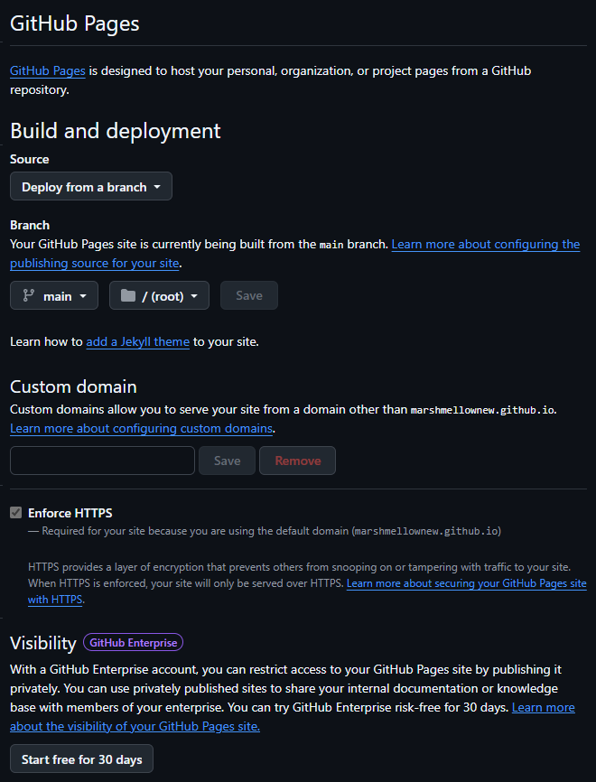

# Тренер — приложение для iPhone без Mac и без сервера

Бесплатное приложение с тренировками на пресс, с гантелями, на ноги и на ягодицы: таймер, озвучка названий и счёта
последних 4 секунд, анимации упражнений, советы по технике, растяжка в конце, календарь и аналитика, подбор программ по
росту, весу и опыту. Все данные хранятся только на телефоне, сервера нет.

## Может ли кто-то изменить моё приложение?
Нет. Сайт на GitHub Pages только отдаётся посетителям: открыть и пользоваться могут все, а изменить файлы может только
владелец репозитория. Прогресс, история и профиль каждого человека лежат в его собственном телефоне и не видны другим.

## Хочу такое же у себя
Скопируй проект в свой аккаунт GitHub (нужна бесплатная регистрация), и приложение будет работать от твоего адреса.

1. Открой страницу репозитория и нажми **Fork** (справа сверху) → **Create fork**. У тебя появится своя копия.
   (Если автор включил режим шаблона, вместо Fork будет зелёная кнопка **Use this template** → **Create a new repository**,
   имя придумай любое, репозиторий сделай **Public**.)
2. В своём репозитории открой **Settings → Pages**. В блоке **Build and deployment**: Source оставь «Deploy from a branch»,
   в Branch выбери **main** и папку **/ (root)**, нажми **Save**.

   

3. Подожди 1–2 минуты. Ссылка появится на этой же странице и выглядит так: `https://<твой-ник>.github.io/<имя-репозитория>/`.
   Готовность можно проверить во вкладке **Actions**: сборка «pages build and deployment» должна стать с зелёной галочкой.
4. Открой ссылку в **Safari** на iPhone → «Поделиться» → «На экран “Домой”» → «Добавить».
   После первого открытия всё работает без интернета.

Свою копию можешь менять как хочешь, на оригинал это не влияет. Если нужно залить много файлов, сделай это командами:
`git init`, `git add .`, `git commit -m "Первая версия"`, `git branch -M main`,
`git remote add origin <адрес-репозитория>`, `git push -u origin main`.

## Голос счёта 4-3-2-1 (по желанию)
Без этого шага счёт говорит голос iPhone (Милена/Юрий). Для более чистого звука:
`pip install edge-tts` → `python tools/make_voice.py` → залей папку `voice/` в репозиторий.

## Программы
- **Пресс → Продвинутый.** Марафоны по 30 дней без конца: день 31 — это начало марафона 2. Повторения растут каждый день,
  планка +2 с в день. В каждом новом марафоне круг упражнений длиннее (до 8), со 2-го марафона появляются новые упражнения.
- **Гантели → Полный сплит** (5 дней в неделю). Каждую неделю +1 повторение, раз в 4 недели начинается новый блок:
  добавляется подход (до +2) и стоит поднять вес на 2,5 кг (вес меняется вручную, он запоминается).
- **Ноги** (3 дня в неделю через день: день 1 без веса, день 2 с гантелями, день 3 смешанный). Если вчера или сегодня уже была
  тренировка этой программы, приложение предложит отдохнуть. Тот же принцип роста, что у гантелей.
- Отдых: упражнения без веса — 30 с после каждого; гантели — 60 с между подходами, 120 с между упражнениями
  (`ABS_REST`, `DB_REST_SET`, `DB_REST_EX` в начале data.js).

## Если нет звука
Открой шестерёнку (настройки) → «Проверить звук»: там написано, есть ли синтез речи и русские голоса. На iPhone проверь, что не включён
беззвучный режим и громкость не на нуле. Звук нужно «разрешить» нажатием «Начать тренировку».

## Важно знать
- Во время тренировки экран не гаснет (Wake Lock). Если заблокировать экран — таймер остановится.
- Первый звук разрешается нажатием «Начать тренировку» (требование iOS).
- Музыка может прерываться голосом: в PWA нельзя приглушать её, как в нативном приложении.
- Дни 1–7 и 27–30 «Пресса» перенесены со скриншотов дословно, круги дней 8–26 подобраны по тому же правилу.
- Отдых: «Пресс» — 30 с между всеми упражнениями; «Гантели» — 60 с между подходами, 120 с между упражнениями
  (значения `ABS_REST`, `DB_REST_SET`, `DB_REST_EX` в начале data.js).
- Анимации упражнений (папка `gif/`) — © Gym visual (gymvisual.com), взяты из набора hasaneyldrm/exercises-dataset.
  Автор набора пишет, что медиа распространяются с разрешения, а для своего использования нужна собственная лицензия
  Gym visual. Для личного приложения на своём телефоне это обычно не проблема, но выкладывать их в публичный
  репозиторий — это раздача файлов. Чтобы обойтись без них: удали `gif/` и поле `gif` у упражнений в data.js —
  приложение вернётся к бесплатным фото из `img/` (общественное достояние, free-exercise-db).
- Слабое соответствие: «Подъём коленей к локтю» (в наборе нет стоячего варианта с касанием локтя, стоит анимация подъёма колена —
  та же, что у бега), «Планка» (с блином), «Жук на спине» (в анимации руки не опускаются).

- **Ягодицы** (3 дня в неделю через день, как «Ноги»).
- **Пресс:** Новичок, Похудение, Опытный и Невероятный пока заглушки.

## Как добавить упражнения и программы
Всё в `data.js`: словарь `EX` (название + имя картинки из `img/`) и список `PROGRAMS`.
