# Тренер: бесплатное приложение для тренировок и питания на iPhone

Приложение работает прямо в Safari и ставится на экран «Домой». Сервера нет, все данные хранятся на телефоне.
Тренировки на пресс, грудь, спину, руки, ноги и ягодицы, таймер с голосом, анимации упражнений, итог тренировки с расчётом калорий, дневник питания, календарь и аналитика.

**Открыть приложение:** https://marshmellownew.github.io/TrainingForIPhone/
**Репозиторий:** https://github.com/MarshmellowNew/TrainingForIPhone

| Главная | Программа | Тренировка |
|---|---|---|
| 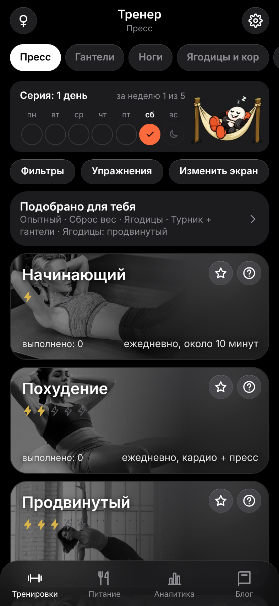 | 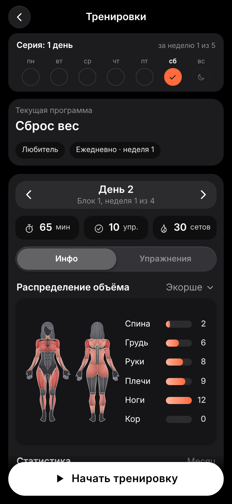 | 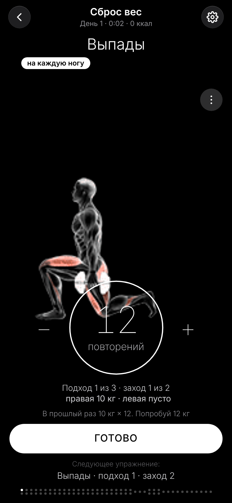 |

| Итог тренировки | История | Аналитика |
|---|---|---|
| 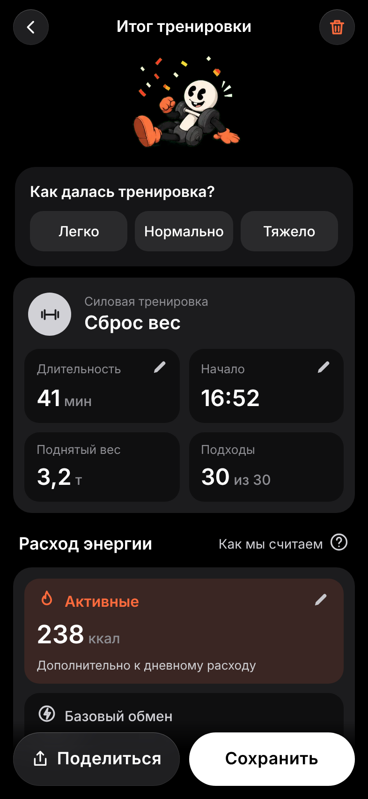 | 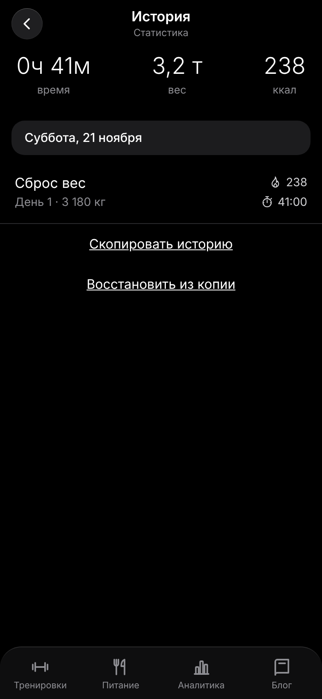 | 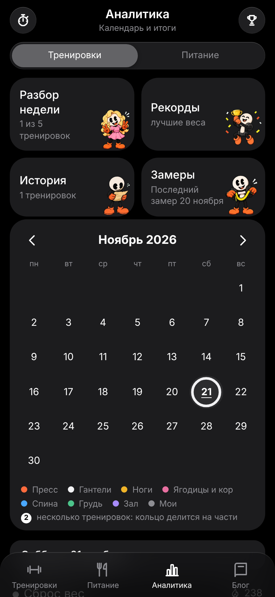 |

| Питание | Дневник | Поиск продуктов |
|---|---|---|
| 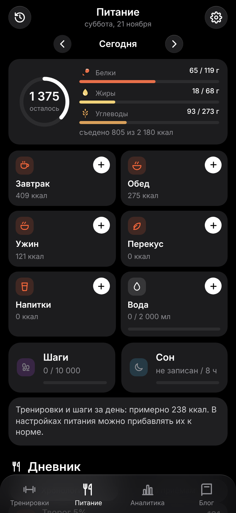 | 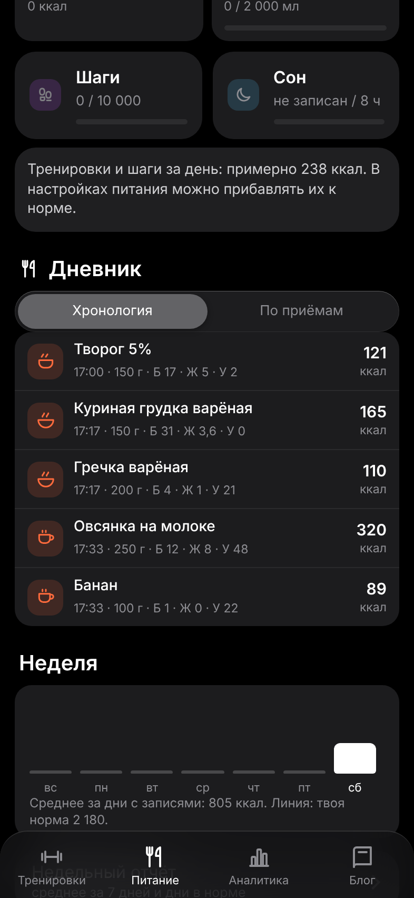 | 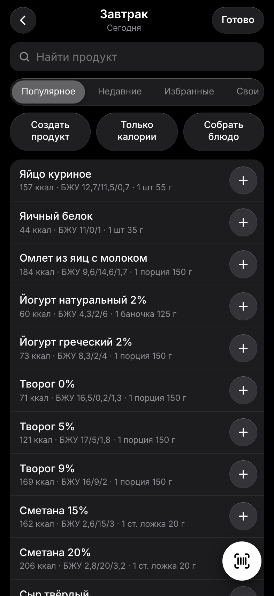 |

| Профиль | Советы | Замеры тела |
|---|---|---|
| 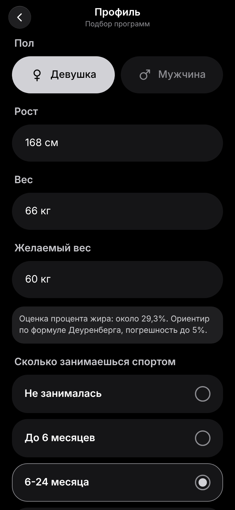 | 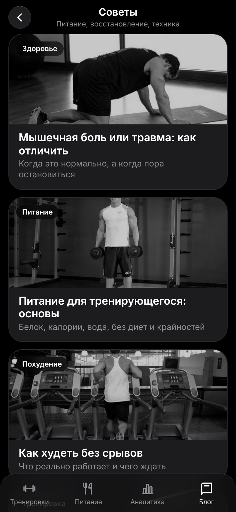 | 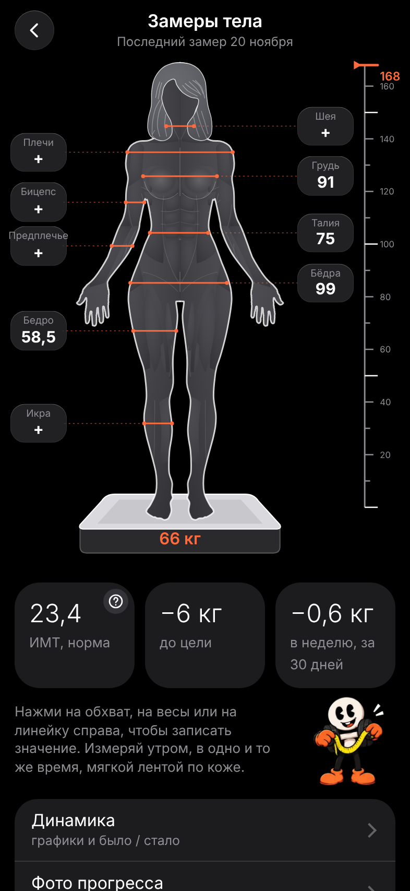 |

## Что умеет
- **Питание.** Анкета с рулетками (цель, пол, единицы, дата рождения, рост, вес, активность, темп), норма калорий по формуле Миффлина-Сан Жеора, кольцо «осталось», белки, жиры и углеводы, четыре приёма пищи, напитки и вода, шаги и сон, дневник с правкой и удалением, переключение дней, неделя.
- **База продуктов.** Около 4400 продуктов и блюд и около 1850 напитков: торты и пирожные по названиям, выпечка, супы, салаты, пицца, шаурма, бургеры, пельмени и вареники, каши, бутерброды, блины, мясо, рыба и овощи с разными способами приготовления, макароны, гречка, рис и другие гарниры с добавками, йогурты со вкусами, мороженое, конфеты, батончики, варенье, пасты. Чай (около 40 видов и 30 марок) с сахаром, мёдом, лимоном, молоком и другими добавками, кофе с разным молоком и сиропами. Поиск, избранное, недавние, свои продукты, быстрый ввод калорий.
- **Напитки и вода.** Карточка «Напитки» сама собирает калории любых напитков, «Вода» учитывает воду, минералку, чай и кофе без молока.
- **Итог тренировки.** После финиша: длительность, начало, поднятый вес, подходы (всё можно поправить), расход энергии (активные и базовый обмен, по формуле MET), нагрузка по мышцам на анатомической фигуре (мужской или женской, по профилю), список упражнений. Окно «Как мы считаем». История открывает такой же итог любой прошлой тренировки.
- **Карточки для публикации.** Из итога можно сделать картинку для сторис (тёмная, светлая, прозрачная), сохранить её или отправить.
- **Живой учёт на тренировке.** Время, калории и поднятый вес считаются по ходу занятия и видны в шапке. Вес считается по реальным гантелям в руках (две одинаковые, разные или одна), в итоге показано «по 10 кг» или «12 + 8 кг».
- **Кнопка плана** на экране тренировки: стоит под кнопкой подсказки, с общим числом подходов в скобках. Открывается только нажатием, показывает упражнения, подходы, повторения, веса и прогресс. Нижней ручки «План тренировки» больше нет.
- **Экран программы.** Текущая программа, листание дней, время, число упражнений и сетов, распределение объёма по мышцам (тело подсвечивается цветом), список упражнений, кольцо дней и статистика.
- **Фильтры программ.** По сложности, времени, избранному и по мышцам (спина, грудь, руки, плечи, ноги, кор).
- **Свои программы.** Конструктор: название, дни в неделю, упражнения из библиотеки, подходы и повторения рулетками.
- **Библиотека упражнений.** Поиск, фильтры по мышцам и инвентарю, карточка с техникой и рабочим весом.
- **Таймер с кольцом.** Голос называет упражнение и считает последние секунды, кнопки − и + меняют повторения или время.
- **Советы по технике** на картинке и голосом, подсказки «на каждую ногу / руку / сторону», растяжка в конце тренировки (подбирается по главным мышцам упражнений дня, 11 видов).
- **Прогрессия без конца.** Повторения, подходы и время растут по дням и неделям.
- **Серия и неделя.** Полоска пн-вс на главной и на экране программы: тренировки отмечены галочкой, выходные значком луны. Выходные дни и число тренировок в неделю задаются в настройках, выходные серию не прерывают.
- **Календарь и аналитика.** Тренировки и питание, три кольца за день (шаги, питание, сон), графики за неделю, месяц, год и всё время.
- **Профиль.** Пол, рост, вес, цель, опыт: приложение подбирает программы. Тест на максимум подгоняет повторения под твои силы.
- **Без интернета.** После первого открытия всё работает офлайн. Данные входят в копию истории.

## Программы
| Группа | Программа | Ритм |
|---|---|---|
| Пресс | Начинающий (дни 1-5 как в оригинале, дальше прогрессия) | ежедневно |
| Пресс | Продвинутый (марафоны по 30 дней) | 3-4 раза в неделю |
| Пресс | Опытный (дни 1-4 как в оригинале, дальше прогрессия) | ежедневно |
| Пресс | Турник (подъёмы в висе, 3 дня в неделю) |
| Пресс | Похудение (кардио + пресс), Невероятный (самый тяжёлый) | ежедневно |
| Гантели | Начинающий, Сброс вес | ежедневно |
| Гантели | Всё тело | 3 дня в неделю |
| Гантели | Полный сплит | 5 дней в неделю |
| Ноги | Ноги, Ноги: начинающий (без веса), Ноги: продвинутый (тяжёлые гантели) | 3 дня в неделю через день |
| Ягодицы и кор | Ягодицы, Ягодицы: начинающий, Ягодицы: продвинутый, Кор | 3 дня в неделю |
| Спина | Начинающий, Спина и поясница, Гантели, Турник: начинающий, Турник, Турник + гантели | 2-3 дня в неделю |
| Грудь | Начинающий (отжимания с колен), Отжимания, Гантели | 2-3 дня в неделю |

У каждой карточки справа вверху кнопка «?»: там написано, что нужно уметь и знать для этой программы. Молнии показывают сложность.

## Может ли кто-то изменить моё приложение?
Нет. Сайт на GitHub Pages только отдаётся посетителям: открыть и пользоваться могут все, а менять файлы может только владелец репозитория. Прогресс, история и профиль каждого человека лежат в его телефоне и не видны другим.

## Хочу такое же у себя
Скопируй проект в свой аккаунт GitHub (бесплатной регистрации достаточно). Приложение будет работать по твоему адресу.

1. Открой страницу репозитория и нажми **Fork** (справа сверху) → **Create fork**.
   (Если у репозитория включён режим шаблона, вместо Fork будет кнопка **Use this template** → **Create a new repository**; репозиторий сделай **Public**.)
2. В своём репозитории открой **Settings → Pages**. Source оставь «Deploy from a branch», в Branch выбери **main** и **/ (root)**, нажми **Save**.

   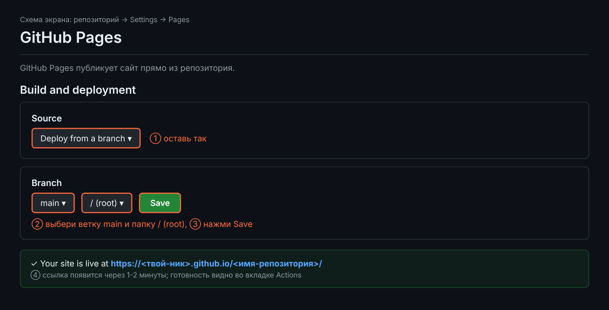

3. Подожди 1-2 минуты. Ссылка появится на этой же странице: `https://<твой-ник>.github.io/<имя-репозитория>/`. Готовность видно во вкладке **Actions**: сборка «pages build and deployment» должна получить зелёную галочку.
4. Открой ссылку в **Safari** на iPhone → «Поделиться» → «На экран “Домой”» → «Добавить».

Если файлов много и браузер не даёт их залить, сделай это командами в папке проекта:
```
git init
git add .
git commit -m "Первая версия"
git branch -M main
git remote add origin https://github.com/<ник>/<репозиторий>.git
git push -u origin main
```
Обновление потом: `git add .`, `git commit -m "Обновление"`, `git push`.

## Голос: как сделать его мягче
Приложение использует голоса iPhone. Стандартный голос звучит роботизированно, а «улучшенный» заметно естественнее:
1. Настройки iPhone → Универсальный доступ → **VoiceOver** → **Речь** → **Основной голос** → Русский (Россия) → скачай **Милена (улучшенный)**, **Катя (улучшенный)** или другой «улучшенный» голос. Включать VoiceOver не нужно.
2. Полностью закрой приложение (смахни из переключателя) и открой снова.
3. В приложении: шестерёнка → **Голос**. В списке у каждого голоса подписано качество («стандартный», «улучшенный», «премиум»): выбери «улучшенный» или «премиум». Голоса Siri сайтам недоступны, это ограничение iOS.
3. Скорость речи в настройках: 0,9-0,95 звучит спокойнее.

Для счёта 4-3-2-1 можно подложить свои записи: `pip install edge-tts` → `python tools/make_voice.py` → загрузи папку `voice/` в репозиторий.

## Если нет звука
Шестерёнка → «Проверить звук»: там написано, есть ли синтез речи и русские голоса. Проверь, что не включён беззвучный режим и громкость не на нуле. Звук разрешается нажатием «Начать тренировку» (требование iOS). Сигналы вместо голоса: шестерёнка → «Последние 4 секунды» → «Сигналы».

## Важно знать
- Во время тренировки экран не гаснет. Если заблокировать экран, таймер остановится.
- Музыка может прерываться голосом: в браузерном приложении нельзя приглушать её, как в нативном.
- Калории и вес считаются приблизительно (по времени работы, твоему весу и весу гантелей).
- Прогрессия основана на списках из исходных тренировок; для дней, которых там нет, значения продолжены по тому же правилу.
- Слабое соответствие анимаций: «Подъём коленей к локтю» (стоит анимация бега с высоким подъёмом колен), «Планка» (с блином), «Жук на спине» (в анимации руки не опускаются). Женских моделей в бесплатных наборах почти нет, поэтому у девушек те же фигуры.

## Лицензии
Анимации упражнений (папка `gif/`) © Gym visual (gymvisual.com), набор hasaneyldrm/exercises-dataset
(https://github.com/hasaneyldrm/exercises-dataset). Автор набора пишет, что медиа распространяются с разрешения,
а для своего использования нужна собственная лицензия Gym visual. Для личного приложения на своём телефоне это обычно не проблема,
но выкладывать их в публичный репозиторий означает раздавать файлы. Чтобы обойтись без них: удали `gif/` и поле `gif` у упражнений в `data.js`:
приложение вернётся к бесплатным фото из `img/` (общественное достояние, free-exercise-db: https://github.com/yuhonas/free-exercise-db).

## Как добавить упражнения и программы
Всё в `data.js`: словарь `EX` (название, номер анимации, советы в `TIPS`, мышцы в `MUSC`) и список `PROGRAMS`.
Константы отдыха `ABS_REST`, `DB_REST_SET`, `DB_REST_EX` лежат в начале файла.


## Турник в тренировках

Подтягивания добавлены в «Полный сплит» (дни спины и рук), «Всё тело» (дни 2 и 3); подъёмы в висе, в конец «Опытного» и «Невероятного» пресса. Отдельные программы с турником, во вкладках «Спина» и «Пресс».

## Зал

Вкладка «Зал» для полностью оборудованного зала: штанги, тренажёры, блоки, гантели, гири, брусья, турник, беговая дорожка. Пять уровней (Новичок, Любитель, Средний, Продвинутый, Профи), у каждого три варианта: 2, 3 или 5 тренировок в неделю.

| Частота | Новичок и Любитель | Средний, Продвинутый, Профи |
|---|---|---|
| 2 дня | всё тело A / B | верх тела / низ тела и пресс |
| 3 дня | всё тело A / B / C | грудь, плечи, трицепс / спина и бицепс / ноги и пресс |
| 5 дней | грудь и трицепс, спина и бицепс, ноги, плечи и пресс, руки и пресс | то же, но пятый день, ягодицы и задняя поверхность |

Каждая тренировка начинается с кардио-разминки (дорожка, эллипс, велотренажёр). Веса подбираются от уровня (для девушек вдвое меньше) и меняются кнопками − и +. Каждую неделю +1 повторение, раз в 4 недели добавляется подход.

## Обновления

Приложение само проверяет новую версию при каждом открытии и раз в 5 минут, пока открыто, и перезагружается на новую (не посреди тренировки). Чтобы после `git push` на телефоне подхватилось, при каждом обновлении кода меняй номер версии кэша `CACHE` в `sw.js` (`trainer-v12` → `trainer-v13`). Первый раз после этого обновления закрой и открой приложение два раза.

## Начало тренировки

Перед первым упражнением идёт 15 секунд подготовки (кнопка «+15 с» добавляет время, «Пропустить» пропускает).

## Инвентарь

Профиль → «Инвентарь» → «Что у тебя есть»: в отдельном окне с картинками выбери гантели («Любые пары» или «Свои», вес каждой добавляется кнопкой, две одинаковые гантели добавляются дважды), отметь, есть ли турник и резинки. Для программ с гантелями приложение подбирает подходящий вариант: пару нужного веса, две разные гантели (каждый подход идёт в два захода со сменой рук, голос проговаривает вес в правой и левой руке) или одну гантель. Без турника подтягивания и висы заменяются упражнениями на полу. С резинками в подсказках появляются варианты усложнения. Для программ зала инвентарь не учитывается.

## Советы и статьи

Вкладка «Советы» (внизу): статьи про питание, похудение, крепатуру и травмы, сон, технику и т. д. Тексты лежат в `articles.js`, картинки, в `img/a/`. Чтобы добавить статью, допиши объект в `ARTICLES` (формат описан в начале файла).

## Фото на карточках

Фото карточек лежат в `img/c/<id программы>.jpg` (чёрно-белые, из базы free-exercise-db, общественное достояние). Для профиля «женский» показываются файлы `img/c/<id>_f.jpg`, у которых id есть в списке `FEM_PHOTOS` в конце `data.js`. Чтобы заменить или добавить фото: положи файл `img/c/<id>_f.jpg` и допиши id в список.

## Избранное

Звёздочка на карточке добавляет тренировку в блок «Избранное» вверху главного экрана.

## Гантели на сегодня и голосовое управление

- **Выбор гантелей.** Перед тренировкой с гантелями приложение спрашивает: «По моему инвентарю», «Одна гантель на обе руки» или «Две разные гантели». От выбора зависят подходы (при одной или двух разных гантелях подход идёт в два захода со сменой рук) и озвучка.
- **Голосовое управление.** В настройках включается пункт «Голосовое управление». Во время тренировки приложение слушает микрофон и по словам «дальше», «готово» или «Тренер, дальше» пропускает текущий подход или отдых, руки не нужны. Если в приложении идёт озвучка, надёжнее говорить «Тренер, дальше». Кнопка микрофона вверху экрана слушает 7 секунд, если постоянный режим подвёл. Нужна включённая диктовка и интернет. На iPhone постоянное прослушивание ограничено самой системой: возможны перезапуски со звуковым сигналом. Микрофон выключается при сворачивании или закрытии приложения и при выходе с экрана тренировки.
- **Итог тренировки.** После тренировки открывается экран итога: длительность и начало (можно править), поднятый вес, подходы, расход энергии (активные, базовый обмен, всего; формула MET в окне «Как мы считаем»), нагрузка по мышцам на фигуре спереди и сзади, список упражнений с лучшим сетом. Из истории итог открывается по нажатию. Карточки для шеринга: «Заливка» и «Прозрачный», кнопки «Скачать» и «Поделиться».

## Анатомические фигуры

Фигуры спереди и сзади лежат в `body.js` (мужская и женская). Силуэт построен по реалистичным референсам, мышцы упрощены до чистых форм. Подсветка идёт по нагрузке: от светлого до красного. Используются в итоге тренировки, аналитике, фильтрах и на карточке для шеринга. На карточке слева от названия стоит иконка приложения.

## Замеры тела (v61)
Экран «Замеры тела» (Профиль или Аналитика). Силуэт спереди, мужской или женский (у девушки волосы и грудь), с рельефом тела и без выделения мышечных групп. На фигуре оранжевые линии показывают, где снимать обхват: шея, плечи, грудь, бицепс, предплечье, талия, бёдра, бедро, икра. Нажми на подпись, введи значение в см. Есть история и график по каждому обхвату. Данные только на телефоне (ключ `meas`).

## Разминка
Настройки, группа «Тренировка», переключатель «Разминка». Если включён, перед основной частью идут лёгкие упражнения (прыжки, high knees и мягкие движения под целевые мышцы). Разминка не попадает в статистику мышц.

## Язык
Настройки, группа «Язык», RU / EN. Переключение перезагружает приложение. Переведены интерфейс, названия упражнений и программ. Подсказки по технике, статьи, продукты и голосовые подсказки пока только на русском. Слой перевода: `i18n.js`.

## Мышечные фигуры
Мышцы прорисованы подробнее и обрезаны по границам своих зон (клипы рук и ног), поэтому не заходят в соседние части тела.

## v62: доработка фигур и маскот
- Женские волосы переделаны (каре с прядями, спереди и сзади), грудь рисуется как естественная форма с линией под ней, а в режиме мышц это отдельная область «грудь».
- Кисти рук перерисованы по референсам: у девушки раскрытая ладонь с пальцами, у мужчины расслабленная кисть.
- Пресс у обеих фигур по референсам: три ряда кубиков с изгибами, длинная нижняя пара, пупок, боковые линии и зубчатая мышца у рёбер.
- На экране тренировки под кнопкой подсказки появилась кнопка плана с общим числом подходов в скобках. Исправлены крестик в поиске продуктов и галочка у «выполнен».
- Фигура девушки стала женственнее (уже плечи, талия, бёдра), волосы до плеч с косой чёлкой и подвёрнутыми кончиками, затылок закрыт (по референсу с набором причёсок). Маскот с рулеткой также на входах в замеры (Профиль и Аналитика).
- Добавление продукта: единицы (шт или г) переключаются кнопками, количество меняется кнопками − и +, под ним быстрые значения (50, 100, 150 г или 1, 2, 3 шт).
- Новые позы маскота (`img/m_*.webp`): гамак на экране «Сегодня по плану отдых», тарелка в пустом дневнике питания, факел для серии (погас, если серии нет), кубок при серии от 7 дней, рулетка на экране замеров.

## v69: экран тренировки и причёска
- Женская причёска повторяет референс: волосы до плеч, косая чёлка, светлые пряди; сзади затылок закрыт.
- Кнопка плана теперь точно под кнопкой подсказки (раньше они перекрывали друг друга), нижняя ручка «План тренировки» убрана.

## v70: доп. функции, блог, недельный разбор

Новые функции включаются в **Настройки, Дополнительно** (по умолчанию выключены, кроме недельного разбора). Выгрузка и загрузка данных доступны всегда: Настройки, Данные.

- **Замена упражнения**: кнопка под планом на экране тренировки, подбирает аналог на ту же мышцу и меняет его во всех оставшихся подходах.
- **Рекорды**: лучший вес и повторения по каждому упражнению, плашка «Новый рекорд» в итоге тренировки, экран рекордов в Аналитике, рекорд на странице упражнения.
- **Подсказка веса**: «в прошлый раз 12 кг × 10, попробуй 14 кг» под строкой подхода.
- **Свои блюда**: кнопка «Собрать блюдо» при добавлении продукта, вкладка «Блюда». **Частые продукты**: вкладка по последним 60 дням.
- **Разбор недели** (Аналитика): накопительная статистика по дням недели (тренировки, время, ккал, поднятый вес), питание, вес, замеры, переключение между неделями.
- **Конец недели**: после последней по плану тренировки недели в итоге появляется карточка с предложением записать вес и замеры.
- **Графики замеров**: динамика по каждому обхвату, было и стало. **Фото прогресса**: хранятся только на телефоне, сравнение двух дат.
- **Блог** вместо «Советов»: карточки Советы, Рецепты (12 блюд с КБЖУ и добавлением в дневник), Упражнения.
- Аналитика собрана компактнее: сверху плитки Разбор недели, Рекорды, Замеры.
- Новые гифки замеров: парень, девушка (по полу в профиле), в костюме для конца недели.
- Календарь: бейджи тренировок заменены на маленькие точки, чтобы не перекрывать числа и кольца.
- Иконки белков, жиров и углеводов в стиле старой анимации: окорочок, капля, колос.
- Цвета интерфейса приведены к палитре: белый, чёрный, оттенки серого и один оранжевый.
- На фигурах добавлены мышцы между лопаткой и плечом (сзади).
- Кнопки подсказки, плана и замены на экране тренировки теперь нажимаются.

| Разбор недели | Блог |
|---|---|
| 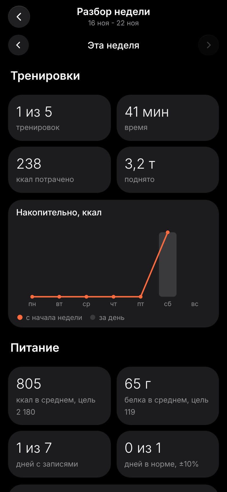 | 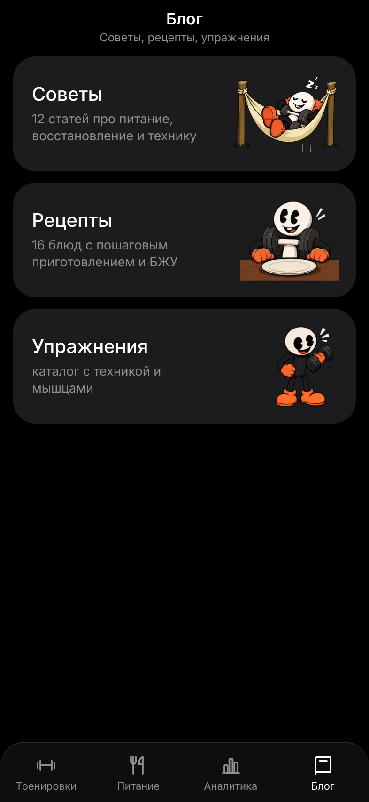 |

## v71: навигация и окна
- Вкладка «История» убрана из нижнего меню, история открывается плиткой в Аналитике.
- В Аналитике строка с днём недели и числом стала карточкой в общем стиле.
- В окнах (настройки, ввод, замеры и др.) кнопки «Готово», «Сохранить» и подобные всегда видны внизу, не нужно листать до конца.

## v72
- В карточке серии только два маскота: с огоньком (серия идёт) и в гамаке (серии нет).
- В блоге у карточки «Упражнения» новый маскот с гантелями.
- Включённые переключатели в настройках снова оранжевые.

## v73
- Календарь в аналитике: группы программ окрашены в приглушённые разные оттенки (янтарь, пыльная роза, сталь, шалфей, лаванда) в тон интерфейсу.

## v74
- Календарь в аналитике: цвета групп стали насыщеннее и различимее (оранжевый, жёлтый, розовый, синий, зелёный, фиолетовый).
- Резинки в настройках: новая картинка `img/eq_band.jpg`, старая не грузилась. Для неё отключён серый фильтр.
- Рецепты: карточки с фото как у тренировок. Фото кладутся в `img/r/r1.jpg` ... `img/r/r12.jpg` (по порядку рецептов). Если файла нет, показывается маскот с тарелкой.
- Исправлено: повторная загрузка картинок (`guardImgs`) больше не мешает картинкам с атрибутом `data-nr`.

## v75
- Окна (шторки) снизу: липкая панель кнопок больше не наезжает на текст, нижний отступ ограничен 24 px (в окне Claude он был огромный).
- Рецепты: 15 блюд, у каждого описание, плашка КБЖУ, ингредиенты, пошаговое приготовление с временем и температурой, совет. КБЖУ пересчитаны по составу.

### Фото для рецептов
Положи файлы в `img/r/` (горизонтальные, примерно 800x480, jpg). Если файла нет, показывается маскот.

r1.jpg: Овсянка с бананом и орехами — Тарелка овсяной каши с нарезанными кружками банана и грецкими орехами, вид сверху
r2.jpg: Омлет с овощами и сыром — Складчатый омлет с кусочками помидора, перца и сыра на тарелке
r3.jpg: Творог с ягодами и мёдом — Миска творога с красными ягодами и тонкой струйкой мёда
r4.jpg: Сырники без муки — Три золотистых сырника на тарелке с ягодами
r5.jpg: Греческий йогурт с гранолой — Стакан йогурта слоями с гранолой и ягодами
r6.jpg: Куриная грудка с рисом и брокколи — Тарелка с нарезанной куриной грудкой, рисом и ярко-зелёной брокколи
r7.jpg: Гречка с говядиной и овощами — Тарелка рассыпчатой гречки с кусочками тушёной говядины, морковью и луком
r8.jpg: Паста с индейкой и томатами — Тарелка спагетти с густым мясным томатным соусом и листиком базилика
r9.jpg: Овощной суп с курицей — Тарелка прозрачного супа с картофелем, морковью и кусочками курицы
r10.jpg: Лосось с картофелем — Запечённый стейк лосося с картофельными дольками, долькой лимона и укропом
r11.jpg: Салат с тунцом и яйцом — Миска зелёного салата с тунцом, половинками яиц и огурцом
r12.jpg: Протеиновый смузи — Высокий стакан кремового банановго смузи с соломинкой
r13.jpg: Треска с овощами в духовке — Запечённое филе трески с кабачком и помидорами на противне с петрушкой
r14.jpg: Бутерброд с яйцом и авокадо — Два тоста с авокадо и яйцом-пашот на деревянной доске
r15.jpg: Протеиновые панкейки с бананом — Стопка небольших панкейков с ломтиками банана
r16.jpg: Яблоко с арахисовой пастой — Дольки яблока рядом с пиалой арахисовой пасты

## v76
- Итог тренировки и карточка для соцсетей: подсвечиваются не только основные мышцы, но и вторичные (вес 0,5, как в плане дня). Для старых записей нагрузка пересчитывается по списку упражнений. Разминочные подходы тоже учитываются.

## v77
- Инвентарь: контурные картинки по фото (человек белым, предмет оранжевым), отдельно для мужчин и девушек (по полу в профиле): `img/eq_<предмет>_<m|f>.webp`.
- Новые предметы: резинка силовая, резинка-петля, беговая дорожка, велотренажёр (переключатели в `inv`: bands, mini, tread, bike). Подсказки с резинкой в упражнениях работают для обеих резинок.
- Для мини-петли у мужчин пока фото девушки (другого не было).

## v78
- Инвентарь: новые фото (оранжевый инвентарь, белая одежда) с удалённым фоном, отдельно для мужчин и девушек.
- Картинки показываются целиком (contain) на тёмной карточке.
- Мини-резинка: одно фото (девушка) для обоих профилей.

## v79
- Звезда избранного и молнии сложности: приглушённый жёлтый.
- Замеры: весы в перспективе под фигурой (нажми, чтобы записать вес) и ростовая линейка справа (нажми, чтобы записать рост). Рост и вес сохраняются с датой, динамика видна во вкладке «Динамика» (добавлены «Вес» и «Рост»).
- Новые маскоты: История (с картой) и Упражнения (с гантелью).
- История: кнопка «назад» как на других экранах.
- Кнопка закрытия выдвижных панелей стала меньше.

## v80
- Замеры: весы теперь на заднем плане, фигура стоит на них.
- Настройки: блок «Дополнительно» убран, функции включены всегда: замена упражнения, рекорды, подсказка веса, свои блюда, частые продукты, недельный отчёт питания, графики замеров, фото прогресса.

## v81
- Фото рецептов r1-r16 подключены.
- Тренировка: оценка «Как далась тренировка» в итоге. «Легко» повышает веса на следующий раз (с учётом твоих гантелей), «Нормально» и «Тяжело» оставляют.
- Таймер: если приложение свёрнуто, сигнал конца отдыха заранее ставится в очередь звука.
- Календарь: настройки, «Тренировки в календарь», файл .ics с напоминанием за 30 минут.
- Замеры: ИМТ, расстояние до цели и темп (кг в неделю).
- Фото прогресса: слайдер «было и стало».
- Питание: сканер штрихкодов (камера, база Open Food Facts) и поиск по номеру вручную.
- Аналитика: блок достижений (18 значков, картинки img/b/<id>.webp, пока заглушки).
- Офлайн: картинки рецептов, инвентаря и маскотов кэшируются заранее, уведомление о потере сети.

## v82
- Достижения: вынесены в кнопку-кубок вверху Аналитики (окно со значками). Пока значок не получен, он серый, после получения цветной. Вместо галочки запасной значок-медаль, пока нет картинки.
- Переключатели (Инфо / Упражнения и все остальные): скругление плашки согласовано со скруглением контейнера.
- Страницы больше не прыгают наверх при нажатии на вкладки и фильтры (Рецепты, Аналитика, Питание, Динамика и др.): положение прокрутки сохраняется при перерисовке того же экрана.
- Штрихкод: плавающая круглая кнопка с иконкой в правом нижнем углу экрана добавления еды.

## v83

- Значки достижений заменены новым набором (прозрачный фон, серые до получения, цветные после).
- Все переключатели (сегменты) во всех группах единые: полностью скруглённая капсула и капсула-плашка.
- Маскот в гамаке больше не перекрывает карточку серии.
- Экран тренировки: подпись «на каждую ногу/руку» теперь под названием, справа одна кнопка, по нажатию выезжают совет, план и замена, через 8 секунд бездействия закрываются; кнопка плана вытянута вверх, число упражнений под иконкой списка.
- Упражнения на каждую сторону показываются зеркально: второй заход (или чётный подход) отображается отражённой картинкой.

## v84

- Подпись «на каждую ногу/руку» на экране тренировки снова слева, под названием упражнения.
- Серия: в выходной день, если серия сохраняется, показывается маскот в гамаке; в обычный день с серией маскот с огоньком; если серия прервалась, маскот с потухшим огоньком.
- Маскоты для «Истории» и «Упражнений» заменены на анимированные.
- В Аналитике слева вверху кнопка «История» (таймер).
- Значок цели (весы) заменён на чистое изображение без водяного знака.

## v85

- Карточки Аналитики: «История» с маскотом-рукописью, «Разбор недели» в костюме (мужчины) или платье (женщины), «Замеры» с маскотом с измерительной лентой для всех.
- Единый стиль стекла: все основные кнопки и секундные кнопки теперь капсулы, мелкие круглые кнопки (избранное, справка, стрелки недель, плюс) и метки замеров получили то же стекло с размытием; кнопки быстрых действий в «Питании» и в шапке «Тренировок» приведены к капсулам.
- Проверены переходы всех экранов (маршруты и кнопки навигации).

## v86

- Навигация: кнопка «Назад» теперь возвращает на предыдущий экран (из Истории, Замеров, Разбора недели, Рекордов, Статьи, Упражнений и т.д.), а не всегда на «Тренировки».
- Сканер штрихкодов: распознавание теперь локальное (`zxing.min.js`), камера не закрывается; видео остаётся на экране, пока идёт поиск. Поиск пробует варианты номера (UPC/EAN), понятнее сообщает, если товара нет в открытой базе Open Food Facts (в ней мало российских товаров).
- Календарь: после «Создать файл» открывается экран с кнопками «Добавить в Календарь» и «Сохранить или поделиться файлом» и коротким пояснением, что нажать дальше.
- ИМТ: в карточке ИМТ в «Замерах» значок вопроса; объясняет, что такое ИМТ, зачем он нужен, почему у тебя именно такая категория, и его ограничения.

## v87

- Календарь: файл .ics исправлен (время создания в UTC, без лишних полей, проверен парсером iCalendar); кнопка «Добавить в Календарь» открывает файл через временную ссылку вместо data:, основной путь: «Сохранить или поделиться файлом» → «Календарь» или «Файлы» → «Добавить все».
- Английский язык: переведены карточки Аналитики и Блога, окно ИМТ, замеры и динамика, достижения, календарь, сканер штрихкода, названия рецептов и приёмов пищи, меню действий на экране тренировки. Названия продуктов из базы и шаги рецептов пока остаются на русском.
- README: все скриншоты обновлены под текущий интерфейс, добавлена схема настроек GitHub Pages (`docs/pages.png`), которая раньше не отображалась.
