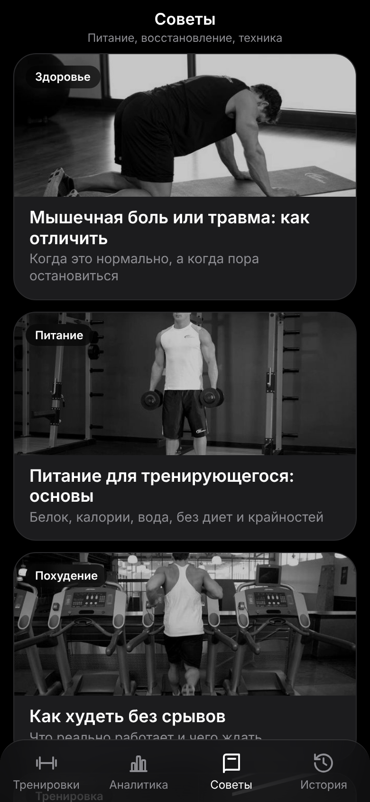

# Тренер: бесплатное приложение для тренировок на iPhone

Приложение работает прямо в Safari и ставится на экран «Домой». Сервера нет, всё хранится на телефоне.
Тренировки на пресс, с гантелями, на ноги и на ягодицы, таймер, голос, анимации упражнений, календарь и аналитика.

**Открыть приложение:** https://marshmellownew.github.io/TrainingForIPhone/
**Репозиторий:** https://github.com/MarshmellowNew/TrainingForIPhone

| Главная | Программа | Тренировка |
|---|---|---|
|  |  |  |

| Аналитика и календарь | Профиль и рекомендации | Советы |
|---|---|---|
|  |  |  |

## Что умеет
- **Питание.** Вкладка «Питание»: пошаговая анкета с рулетками выбора (цель, пол, единицы, дата рождения, рост, вес, активность, темп), норма калорий по профилю (формула Миффлина-Сан Жеора, темп 10/15/20% дефицита), кольцо «осталось», белки/жиры/углеводы, четыре приёма пищи, дневник с правкой и удалением, переключение дней и неделя. База около 650 продуктов и 80 напитков, карточки «Напитки» и «Вода» (плюс сразу добавляет 50 мл), поиск, избранное, недавние, свои продукты и быстрый ввод калорий. Всё хранится на телефоне и входит в копию истории.
- **Свои программы.** Вкладка «Мои» на главной: конструктор (название, дни в неделю, упражнения из библиотеки, подходы и повторения рулетками), предпросмотр, правка и удаление. Входит в копию истории.
- **Библиотека упражнений.** Кнопка «Упражнения» на главной: поиск, фильтры по мышцам и инвентарю, карточка упражнения с техникой, рабочим весом и добавлением в свою программу.
- **Фильтры и правка главной.** Фильтры по сложности, времени и избранному; порядок и видимость разделов, блок «Подобрано для тебя».
- **Питание, дополнительно.** Календарь по кнопке слева вверху, сон, экран приёма пищи, «Щедрый повар» (+10%), шаги, имя, оценка процента жира, хронология и копирование на другой день.
- **Аналитика питания.** В «Аналитике» переключатель «Тренировки / Питание» над календарём: календарь с тремя кольцами (шаги, питание, сон), значками тренировки и «идеального дня», итоги дня по приёмам, средние калории, белок, вода и шаги, графики за 7 дней, 30 дней, год и всё время.
- **Таймер с кольцом.** Голос называет упражнение и считает последние 4 секунды (или звучат сигналы, переключатель в настройках).
- **Кнопки − и +** рядом с кольцом: меняют число повторений (на 1) или время (на 5 секунд), если не получилось выполнить норму.
- **Советы по технике.** Кнопка «i» на картинке упражнения. Те же советы звучат голосом во время упражнения (можно выключить).
- **«На каждую ногу / руку / сторону».** Подсказка на картинке и голосом.
- **Растяжка в конце** каждой тренировки на те мышцы, что работали, с отдельными анимациями.
- **Отдых.** Без веса 30 секунд; с гантелями 60 секунд между подходами и 120 секунд между упражнениями.
- **Прогрессия без конца.** Повторения, подходы и время растут по дням и неделям, дни не заканчиваются.
- **Календарь и аналитика.** Тренировки обведены кружком, несколько за день делят кружок на части. Калории и время по дням, общий вес.
- **Профиль.** Пол, рост, вес, желаемый вес, опыт и активность: приложение рекомендует программы. Для девушек вес гантелей вдвое меньше, а число повторений без веса ×0,85. «Тест на максимум» подгоняет число повторений под твои силы.
- **Без интернета.** После первого открытия всё работает офлайн.

## Программы
| Группа | Программа | Ритм |
|---|---|---|
| Пресс | Начинающий (дни 1-5 как в оригинале, дальше прогрессия) | ежедневно |
| Пресс | Продвинутый (марафоны по 30 дней) | 3-4 раза в неделю |
| Пресс | Опытный (дни 1-4 как в оригинале, дальше прогрессия) | ежедневно |
| Пресс | Турник (подъёмы в висе, 3 дня в неделю) |
| Пресс | Похудение (кардио + пресс), Невероятный (самый тяжёлый) | ежедневно |
| Гантели | Начинающий, Сброс вес | ежедневно |
| Гантели | Всё тело | 3 дня в неделю |
| Гантели | Полный сплит | 5 дней в неделю |
| Ноги | Ноги, Ноги: начинающий (без веса), Ноги: продвинутый (тяжёлые гантели) | 3 дня в неделю через день |
| Ягодицы и кор | Ягодицы, Ягодицы: начинающий, Ягодицы: продвинутый, Кор | 3 дня в неделю |
| Спина | Начинающий, Спина и поясница, Гантели, Турник: начинающий, Турник, Турник + гантели | 2-3 дня в неделю |
| Грудь | Начинающий (отжимания с колен), Отжимания, Гантели | 2-3 дня в неделю |

У каждой карточки справа вверху кнопка «?»: там написано, что нужно уметь и знать для этой программы. Молнии показывают сложность.

## Может ли кто-то изменить моё приложение?
Нет. Сайт на GitHub Pages только отдаётся посетителям: открыть и пользоваться могут все, а менять файлы может только владелец репозитория. Прогресс, история и профиль каждого человека лежат в его телефоне и не видны другим.

## Хочу такое же у себя
Скопируй проект в свой аккаунт GitHub (бесплатной регистрации достаточно). Приложение будет работать по твоему адресу.

1. Открой страницу репозитория и нажми **Fork** (справа сверху) → **Create fork**.
   (Если у репозитория включён режим шаблона, вместо Fork будет кнопка **Use this template** → **Create a new repository**; репозиторий сделай **Public**.)
2. В своём репозитории открой **Settings → Pages**. Source оставь «Deploy from a branch», в Branch выбери **main** и **/ (root)**, нажми **Save**.

   

3. Подожди 1-2 минуты. Ссылка появится на этой же странице: `https://<твой-ник>.github.io/<имя-репозитория>/`. Готовность видно во вкладке **Actions**: сборка «pages build and deployment» должна получить зелёную галочку.
4. Открой ссылку в **Safari** на iPhone → «Поделиться» → «На экран “Домой”» → «Добавить».

Если файлов много и браузер не даёт их залить, сделай это командами в папке проекта:
```
git init
git add .
git commit -m "Первая версия"
git branch -M main
git remote add origin https://github.com/<ник>/<репозиторий>.git
git push -u origin main
```
Обновление потом: `git add .`, `git commit -m "Обновление"`, `git push`.

## Голос: как сделать его мягче
Приложение использует голоса iPhone. Стандартный голос звучит роботизированно, а «улучшенный» заметно естественнее:
1. Настройки iPhone → Универсальный доступ → **VoiceOver** → **Речь** → **Основной голос** → Русский (Россия) → скачай **Милена (улучшенный)**, **Катя (улучшенный)** или другой «улучшенный» голос. Включать VoiceOver не нужно.
2. Полностью закрой приложение (смахни из переключателя) и открой снова.
3. В приложении: шестерёнка → **Голос**. В списке у каждого голоса подписано качество («стандартный», «улучшенный», «премиум»): выбери «улучшенный» или «премиум». Голоса Siri сайтам недоступны, это ограничение iOS.
3. Скорость речи в настройках: 0,9-0,95 звучит спокойнее.

Для счёта 4-3-2-1 можно подложить свои записи: `pip install edge-tts` → `python tools/make_voice.py` → загрузи папку `voice/` в репозиторий.

## Если нет звука
Шестерёнка → «Проверить звук»: там написано, есть ли синтез речи и русские голоса. Проверь, что не включён беззвучный режим и громкость не на нуле. Звук разрешается нажатием «Начать тренировку» (требование iOS). Сигналы вместо голоса: шестерёнка → «Последние 4 секунды» → «Сигналы».

## Важно знать
- Во время тренировки экран не гаснет. Если заблокировать экран, таймер остановится.
- Музыка может прерываться голосом: в браузерном приложении нельзя приглушать её, как в нативном.
- Калории и вес считаются приблизительно (по времени работы, твоему весу и весу гантелей).
- Прогрессия основана на списках из исходных тренировок; для дней, которых там нет, значения продолжены по тому же правилу.
- Слабое соответствие анимаций: «Подъём коленей к локтю» (стоит анимация бега с высоким подъёмом колен), «Планка» (с блином), «Жук на спине» (в анимации руки не опускаются). Женских моделей в бесплатных наборах почти нет, поэтому у девушек те же фигуры.

## Лицензии
Анимации упражнений (папка `gif/`) © Gym visual (gymvisual.com), набор hasaneyldrm/exercises-dataset
(https://github.com/hasaneyldrm/exercises-dataset). Автор набора пишет, что медиа распространяются с разрешения,
а для своего использования нужна собственная лицензия Gym visual. Для личного приложения на своём телефоне это обычно не проблема,
но выкладывать их в публичный репозиторий означает раздавать файлы. Чтобы обойтись без них: удали `gif/` и поле `gif` у упражнений в `data.js`:
приложение вернётся к бесплатным фото из `img/` (общественное достояние, free-exercise-db: https://github.com/yuhonas/free-exercise-db).

## Как добавить упражнения и программы
Всё в `data.js`: словарь `EX` (название, номер анимации, советы в `TIPS`, мышцы в `MUSC`) и список `PROGRAMS`.
Константы отдыха `ABS_REST`, `DB_REST_SET`, `DB_REST_EX` лежат в начале файла.


## Турник в тренировках

Подтягивания добавлены в «Полный сплит» (дни спины и рук), «Всё тело» (дни 2 и 3); подъёмы в висе, в конец «Опытного» и «Невероятного» пресса. Отдельные программы с турником, во вкладках «Спина» и «Пресс».

## Зал

Вкладка «Зал» для полностью оборудованного зала: штанги, тренажёры, блоки, гантели, гири, брусья, турник, беговая дорожка. Пять уровней (Новичок, Любитель, Средний, Продвинутый, Профи), у каждого три варианта: 2, 3 или 5 тренировок в неделю.

| Частота | Новичок и Любитель | Средний, Продвинутый, Профи |
|---|---|---|
| 2 дня | всё тело A / B | верх тела / низ тела и пресс |
| 3 дня | всё тело A / B / C | грудь, плечи, трицепс / спина и бицепс / ноги и пресс |
| 5 дней | грудь и трицепс, спина и бицепс, ноги, плечи и пресс, руки и пресс | то же, но пятый день, ягодицы и задняя поверхность |

Каждая тренировка начинается с кардио-разминки (дорожка, эллипс, велотренажёр). Веса подбираются от уровня (для девушек вдвое меньше) и меняются кнопками − и +. Каждую неделю +1 повторение, раз в 4 недели добавляется подход.

## Обновления

Приложение само проверяет новую версию при каждом открытии и раз в 5 минут, пока открыто, и перезагружается на новую (не посреди тренировки). Чтобы после `git push` на телефоне подхватилось, при каждом обновлении кода меняй номер версии кэша `CACHE` в `sw.js` (`trainer-v12` → `trainer-v13`). Первый раз после этого обновления закрой и открой приложение два раза.

## Начало тренировки

Перед первым упражнением идёт 15 секунд подготовки (кнопка «+15 с» добавляет время, «Пропустить» пропускает).

## Инвентарь

Профиль → «Инвентарь» → «Что у тебя есть»: в отдельном окне с картинками выбери гантели («Любые пары» или «Свои», вес каждой добавляется кнопкой, две одинаковые гантели добавляются дважды), отметь, есть ли турник и резинки. Для программ с гантелями приложение подбирает подходящий вариант: пару нужного веса, две разные гантели (каждый подход идёт в два захода со сменой рук, голос проговаривает вес в правой и левой руке) или одну гантель. Без турника подтягивания и висы заменяются упражнениями на полу. С резинками в подсказках появляются варианты усложнения. Для программ зала инвентарь не учитывается.

## Советы и статьи

Вкладка «Советы» (внизу): статьи про питание, похудение, крепатуру и травмы, сон, технику и т. д. Тексты лежат в `articles.js`, картинки, в `img/a/`. Чтобы добавить статью, допиши объект в `ARTICLES` (формат описан в начале файла).

## Фото на карточках

Фото карточек лежат в `img/c/<id программы>.jpg` (чёрно-белые, из базы free-exercise-db, общественное достояние). Для профиля «женский» показываются файлы `img/c/<id>_f.jpg`, у которых id есть в списке `FEM_PHOTOS` в конце `data.js`. Чтобы заменить или добавить фото: положи файл `img/c/<id>_f.jpg` и допиши id в список.

## Избранное

Звёздочка на карточке добавляет тренировку в блок «Избранное» вверху главного экрана.

## Гантели на сегодня и голосовое управление

- **Выбор гантелей.** Перед тренировкой с гантелями приложение спрашивает: «По моему инвентарю», «Одна гантель на обе руки» или «Две разные гантели». От выбора зависят подходы (при одной или двух разных гантелях подход идёт в два захода со сменой рук) и озвучка.
- **Голосовое управление.** В настройках включается пункт «Голосовое управление». Во время тренировки приложение слушает микрофон и по словам «дальше», «готово» или «Тренер, дальше» пропускает текущий подход или отдых, руки не нужны. Если в приложении идёт озвучка, надёжнее говорить «Тренер, дальше». Кнопка микрофона вверху экрана слушает 7 секунд, если постоянный режим подвёл. Нужна включённая диктовка и интернет. На iPhone постоянное прослушивание ограничено самой системой: возможны перезапуски со звуковым сигналом. Микрофон выключается при сворачивании или закрытии приложения и при выходе с экрана тренировки.
